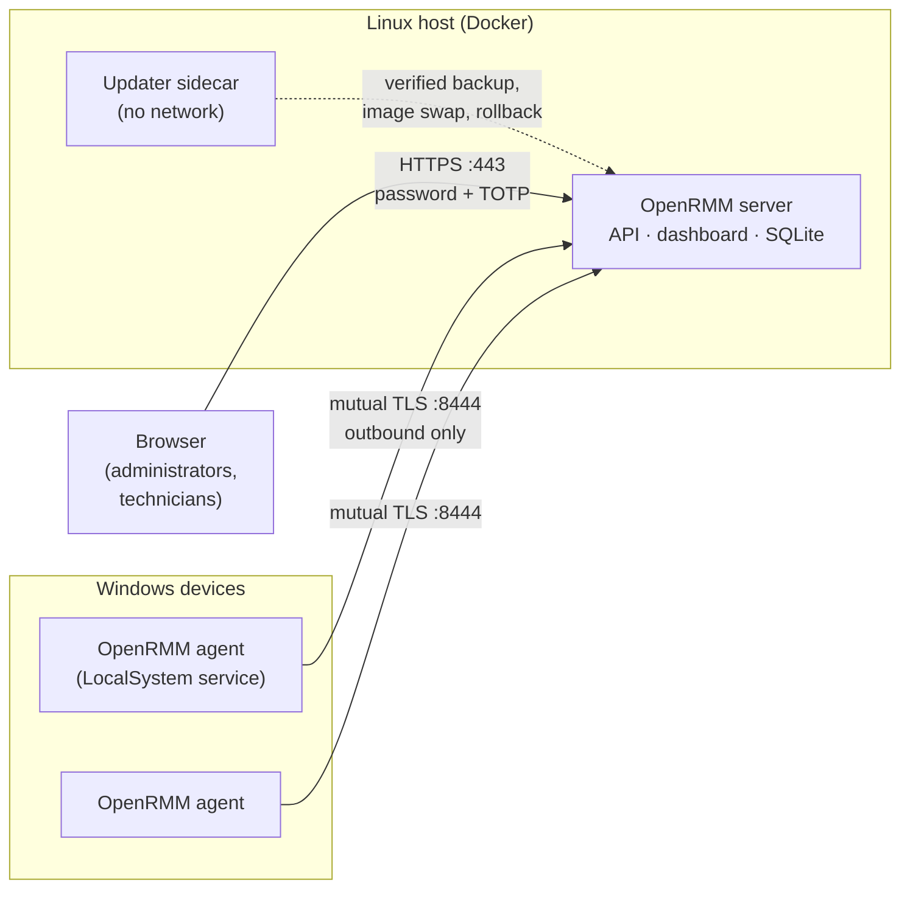

<div align="center">

# OpenRMM

**Self-hosted remote monitoring and management with built-in forensic live response for Windows fleets.**

[](https://github.com/IAmForeverAloneToo/OpenRMM/actions/workflows/ci.yml)
[](LICENSE)
[](go.mod)
[](docs/WINDOWS-SERVICE.md)
[](docs/INSTALL.md)
[](ROADMAP.md)

[Install](#install) · [Features](#features) · [Documentation](docs/README.md) · [Roadmap](ROADMAP.md) · [Security](SECURITY.md) · [Contributing](CONTRIBUTING.md)

</div>

---

OpenRMM gives one administrator, or a small team of technicians, a single dashboard to watch, manage and investigate Windows machines they own. It is one Go server, which you run yourself with Docker, plus a lightweight Windows agent that connects outwards over mutually authenticated TLS. There is no cloud service, telemetry or third-party account involved.

It combines classic RMM functions with the forensic tools a responder needs during an incident: cases with a tamper-evident chain of custody, evidence collection, a live response console, triage packages, fleet-wide hunts and network isolation.

> [!IMPORTANT]
> OpenRMM is **pre-release software**. Expect breaking changes until the first tagged release, and read [SECURITY.md](SECURITY.md) before exposing a server to the internet.

## Features

| Area | What you get |
| --- | --- |
| **Fleet monitoring** | [Inventory](docs/INVENTORY.md) and [device information](docs/DEVICE-INFO.md), [CPU](docs/CPU.md), [memory](docs/MEMORY.md), [disk space](docs/DISK-SPACE.md) and [uptime](docs/UPTIME.md) with [historical metrics](docs/METRICS.md), [heartbeats](docs/HEARTBEATS.md), [BitLocker and Defender status](docs/SECURITY-STATUS.md) |
| **Users and accounts** | [Signed-in sessions](docs/SESSIONS.md), [logon history](docs/LOGONS.md), [local accounts and privileged groups](docs/LOCAL-ACCOUNTS.md) |
| **Alerting** | [Alerts with optional e-mail](docs/ALERTS.md), [service health checks](docs/HEALTH-CHECKS.md) with guarded remediation |
| **Management** | [PowerShell scripts](docs/SCRIPTS.md) with fleet batches and [schedules](docs/SCHEDULES.md), [Windows Update](docs/WINDOWS-UPDATES.md) and [patch policies](docs/PATCH-POLICIES.md), [MSI app deployment](docs/APPLICATIONS.md), [services](docs/SERVICE-MANAGEMENT.md), [processes](docs/PROCESSES.md), [installed software](docs/SOFTWARE.md) |
| **Remote access** | [Interactive terminal](docs/TERMINAL.md), [remote desktop](docs/DESKTOP.md), [file browsing and transfer](docs/FILES.md) |
| **Incident response** | [Cases, evidence and chain of custody](docs/RESPONSE.md), [live response console](docs/RESPONSE.md), [triage packages](docs/TRIAGE.md), [persistence report](docs/PERSISTENCE.md), [event logs and fleet log search](docs/EVENT-LOGS.md), [indicator hunts](docs/HUNTING.md), [network isolation](docs/ISOLATION.md) |
| **Organization** | [Groups, tags and monitoring policies](docs/ORGANIZATION.md), [technician accounts](docs/TECHNICIANS.md) with mandatory MFA and scoped permissions |
| **Lifecycle** | [One-command server install](docs/INSTALL.md) with automatic HTTPS, [server updates from the dashboard](docs/SERVER-UPDATES.md), [signed agent updates](docs/AGENT-UPDATES.md) through pilot rings, [backup and recovery](docs/RECOVERY.md) |

## How it works



- **Server.** One Go binary in a non-root, read-only container. It hosts the JSON API, the embedded React dashboard and SQLite storage. Case evidence is kept in its own volume.
- **Agent.** One Windows service running as LocalSystem. It always initiates the connection, so devices need no inbound ports. Each device holds its own client certificate issued at enrollment.
- **Trust.** Agent and server releases are signed with Ed25519 and verified before they are installed. Every administrative and response action is audited, and evidence is recorded in a hash-chained custody log that can be verified offline.
- **Small footprint.** Dependencies are kept to a minimum and locked. See [DEPENDENCIES.md](docs/DEPENDENCIES.md).

## Install

On a Linux host with Docker Engine and the Compose plugin:

```bash
# Public server: automatic Let's Encrypt certificate, dashboard on port 443
sudo bash deploy/install.sh --image IMAGE:VERSION --domain rmm.example.com
```

```bash
# LAN or lab server: certificates from the server's own authority
sudo bash deploy/install.sh --image IMAGE:VERSION --address 192.0.2.10
```

1. Open the one-time setup link the script prints (valid for one hour) to create the first administrator with a password and an authenticator app.
2. In the dashboard, go to **Devices → Add device** and download an installer for one device or for a deployment to many.
3. On each Windows machine, run `install.cmd` (or `install.cmd /quiet` from Intune, Group Policy or a remote shell). The device appears in **Devices** within a minute.

> [!NOTE]
> Published container images will be available with the first tagged release. Until then, build the image from source; see [DEVELOPMENT.md](docs/DEVELOPMENT.md).

Running the install command again repairs or reconfigures the installation without touching data. The full guide is in [INSTALL.md](docs/INSTALL.md).

## Documentation

Start at the **[documentation index](docs/README.md)**. Frequently used pages:

- [Installing the server](docs/INSTALL.md) · [Server updates](docs/SERVER-UPDATES.md) · [Backup and recovery](docs/RECOVERY.md)
- [Enrolling devices](docs/ENROLLMENT.md) · [The Windows agent service](docs/WINDOWS-SERVICE.md) · [Agent updates](docs/AGENT-UPDATES.md)
- [Incident response](docs/RESPONSE.md) · [Hunting](docs/HUNTING.md) · [Network isolation](docs/ISOLATION.md)
- [Configuration reference](docs/CONFIGURATION.md) · [Development guide](docs/DEVELOPMENT.md)

## Project status

OpenRMM is under active development towards its first public release. The server and agent described above are working. The roadmap tracks what is still open, notably:
- the release pipeline that publishes signed images and agent packages;
- enforcing network isolation, which currently runs as a dry run;
- agents for platforms other than Windows.

See [ROADMAP.md](ROADMAP.md).

## Security

Please report vulnerabilities privately through [GitHub's private vulnerability reporting](https://github.com/IAmForeverAloneToo/OpenRMM/security/advisories/new). Never use a public issue for this. Details are in [SECURITY.md](SECURITY.md).

## Contributing

Bug reports, ideas and pull requests are welcome. Please read [CONTRIBUTING.md](CONTRIBUTING.md) first; it covers the development setup, the dependency policy and how changes are checked.

## License

OpenRMM is licensed under the **GNU Affero General Public License v3.0 only** ([AGPL-3.0-only](LICENSE)). If you run a modified version as a network service, the AGPL requires you to offer its source to its users. Third-party components keep their own licenses; see [NOTICE](NOTICE), [THIRD_PARTY_NOTICES.md](THIRD_PARTY_NOTICES.md) and [LICENSING.md](docs/LICENSING.md).
